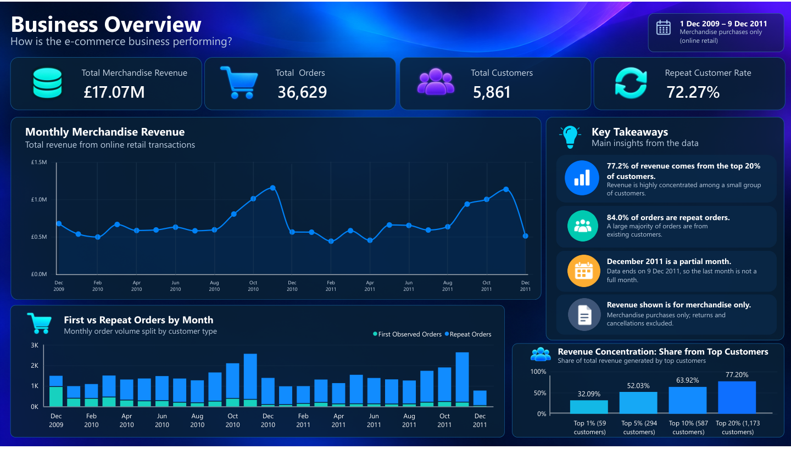
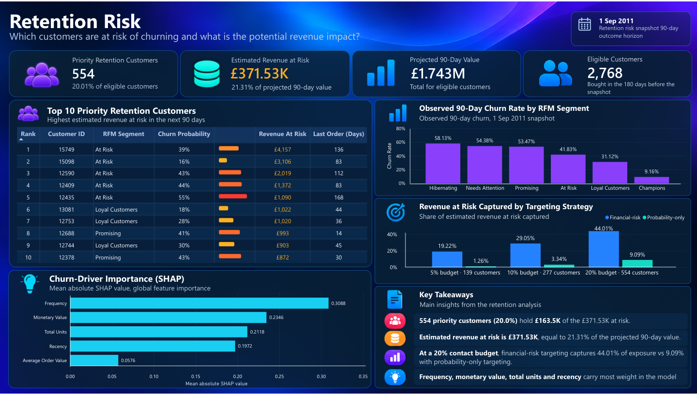
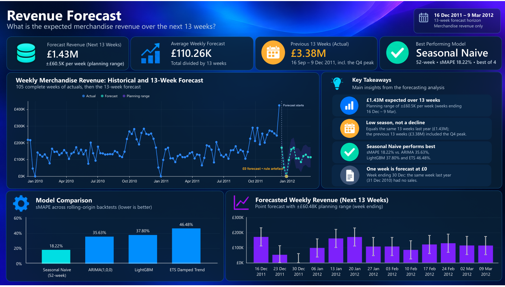
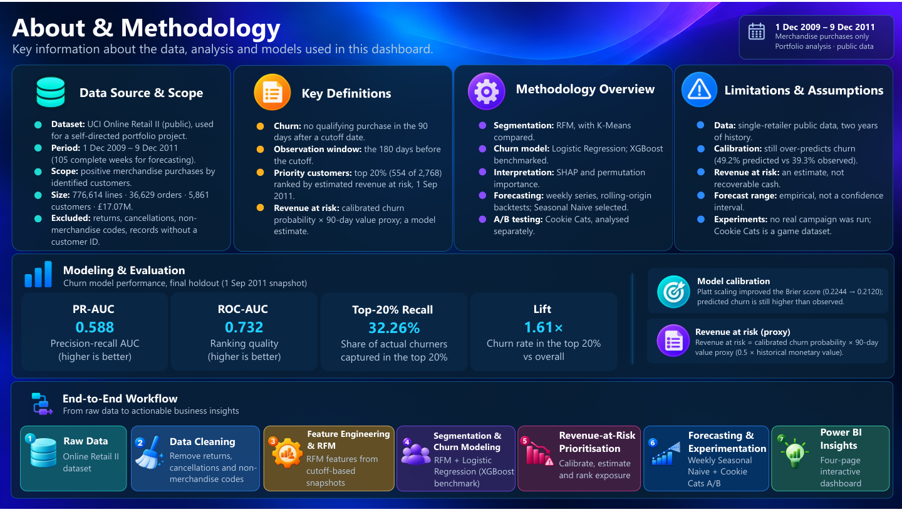

# Retail Customer Retention Intelligence

End-to-end customer-retention analytics project using transactional retail data, machine learning, forecasting, experimentation, PostgreSQL, and Power BI.

The project follows a business-focused workflow:

**Understand customer behavior → identify churn risk → explain it → quantify financial risk → forecast revenue → test an intervention → communicate insights in Power BI.**

This is a self-directed portfolio project using public datasets. Revenue-at-risk estimates and the proposed retailer retention experiment are analytical outputs rather than observed business impact.

---

## Project Overview

The project analyzes customer purchasing behavior for a UK-based online retailer and addresses several business questions:

- How is the business performing?
- Which customers are most likely to churn?
- Which customers represent the greatest financial risk?
- Which behavioral factors drive churn predictions?
- What revenue should the retailer expect over the next 13 weeks?
- How could a retention intervention be evaluated experimentally?

The analysis combines:

- SQL business analytics;
- exploratory and statistical analysis;
- RFM customer segmentation;
- churn prediction;
- probability calibration;
- SHAP model explainability;
- revenue-at-risk prioritization;
- time-series forecasting;
- A/B testing and experiment design;
- Power BI reporting.

---

## Dataset

The main project uses the **UCI Online Retail II** public dataset containing transaction-level data for a UK-based online retailer between December 2009 and December 2011.

After cleaning and restricting the analysis to identified merchandise purchases:

| Metric | Value |
|---|---:|
| Transaction lines | 776,614 |
| Customers | 5,861 |
| Orders | 36,629 |
| Merchandise revenue | £17.07M |
| Date range | 1 Dec 2009 – 9 Dec 2011 |

Returns, cancellations, non-merchandise transaction codes, and transactions without a customer ID are excluded from the analysis-ready merchandise dataset.

Phase 6 additionally uses the public **Cookie Cats** randomized-experiment dataset for A/B-test analysis.

---

## Key Results

### Customer Behavior

- **72.27%** of customers made more than one merchandise purchase.
- **84.0%** of merchandise orders were repeat orders.
- The top **20% of customers generated 77.20% of total revenue**.
- Purchasing behavior showed strong year-end seasonality.

### Churn Modeling

Churn is defined as making **no qualifying purchase during the 90 days following a customer snapshot**.

Customer features are calculated using the preceding **180-day observation window**.

Two models were compared:

- Logistic Regression
- XGBoost

Logistic Regression was retained because it provided slightly stronger validation performance while remaining easier to interpret.

Final holdout performance:

| Metric | Result |
|---|---:|
| PR-AUC | 0.588 |
| ROC-AUC | 0.732 |
| Top-20% Recall | 32.26% |
| Lift at Top 20% | 1.61× |

Probability calibration using **Platt scaling** improved the Brier score from **0.2244 to 0.2120**.

---

## Model Explainability

Model behavior was examined using:

- Logistic Regression coefficients;
- Variance Inflation Factors;
- permutation importance;
- correlation-aware SHAP.

Global SHAP importance:

| Feature | Mean absolute SHAP |
|---|---:|
| Frequency | 0.3088 |
| Monetary Value | 0.2346 |
| Total Units | 0.2118 |
| Recency | 0.1972 |
| Average Order Value | 0.0576 |

Purchase frequency was the strongest overall predictive signal.

Because several purchasing variables are highly correlated, individual model coefficients are not interpreted as independent causal effects.

---

## Revenue-at-Risk Prioritization

Churn probability alone does not account for customer value.

A financial-prioritization metric was therefore created:

**90-day value proxy = 180-day monetary value × 0.5**

**Revenue at risk = calibrated churn probability × 90-day value proxy**

For the 1 September 2011 retention snapshot:

- **Eligible customers:** 2,768
- **Projected 90-day customer value:** £1.743M
- **Estimated revenue at risk:** £371.53K
- **Priority customers:** 554
- **Priority group size:** approximately 20%

The priority group captures **44.01% of estimated revenue at risk**.

### Financial-Risk vs Probability-Only Targeting

| Contact Budget | Financial-Risk Ranking | Churn-Probability Ranking |
|---|---:|---:|
| 5% | 19.22% | 1.26% |
| 10% | 29.05% | 3.34% |
| 20% | 44.01% | 9.09% |

This demonstrates the difference between predicting **who is most likely to churn** and identifying **whose loss represents the greatest modeled financial exposure**.

---

## Revenue Forecasting

Weekly merchandise revenue was forecast over a **13-week horizon**.

Four approaches were evaluated using chronological rolling-origin backtesting:

| Model | MAE | RMSE | sMAPE |
|---|---:|---:|---:|
| Seasonal Naive (52-week) | £30,106.90 | £44,972.90 | **18.22%** |
| ARIMA(1,0,0) | £56,555.01 | £77,595.31 | 35.63% |
| LightGBM | £60,541.55 | £80,225.80 | 37.80% |
| ETS Damped Trend | £79,384.10 | £101,253.41 | 46.48% |

The **52-week Seasonal Naive model** achieved the strongest out-of-sample performance.

Final forecast:

- **Forecast horizon:** 16 Dec 2011 – 9 Mar 2012
- **13-week revenue forecast:** £1,433,386.67
- **Average weekly forecast:** £110,260.51
- **Empirical planning range:** ±£60,478.76 per week

One week receives a £0 point forecast because the corresponding week 52 weeks earlier recorded no qualifying merchandise revenue. This is explicitly treated as a **model-rule artefact**, rather than a certainty that future revenue would be zero.

---

## Experimentation & A/B Testing

The project also demonstrates causal experiment analysis using the public **Cookie Cats** randomized experiment.

### Primary Outcome: 7-Day Retention

| Group | Retention |
|---|---:|
| gate_30 | 19.02% |
| gate_40 | 18.20% |

Results:

- Absolute effect: approximately **-0.82 percentage points**
- p-value: **0.001554**
- 95% CI: **-1.33 to -0.31 percentage points**

**Recommendation: do not ship `gate_40` if the objective is to improve 7-day retention.**

This causal conclusion applies only to the Cookie Cats experiment.

### Proposed Retail Experiment

A hypothetical retailer retention-offer experiment was also designed.

Using a historical 30-day repeat-purchase rate of **28.03%** and a target uplift of **+3 percentage points**, approximately:

**7,256 customers**

would be required for 80% statistical power under a 50/50 randomized design.

No actual retention campaign was run on the retail dataset.

---

# Power BI Dashboard

The final analysis is presented through a **four-page interactive Power BI report**.

The report contains:

1. **Business Overview**
2. **Retention Risk**
3. **Revenue Forecast**
4. **About & Methodology**

The complete Power BI report is available here:

**[Download the Power BI report](dashboard/retail_customer_retention_dashboard.pbix)**

A static PDF version is also included:

**[View the dashboard PDF](dashboard/retail_customer_retention_dashboard.pdf)**

A public Power BI web link is not available because public embedding is restricted by the Power BI tenant used during development.

---

## Dashboard Preview

### 1. Business Overview

Historical revenue, customers, orders, repeat purchasing, and revenue concentration.



### 2. Retention Risk

Customer-level retention prioritization, estimated revenue at risk, RFM churn rates, SHAP importance, and financial-risk targeting.



### 3. Revenue Forecast

Historical weekly revenue, the selected 13-week forecast, planning range, and model comparison.



### 4. About & Methodology

Data definitions, model evaluation, assumptions, limitations, and the end-to-end analytical workflow.



---

## Dashboard Data Preparation

`notebooks/08_dashboard_data_preparation.ipynb` creates the validated datasets used by Power BI.

Rather than manually entering analysis results into the dashboard, the notebook produces dashboard-ready exports from the same cleaned transaction data and modeling workflow used throughout the project.

Outputs include:

- monthly business metrics;
- first-observed vs repeat-order trends;
- customer revenue concentration;
- business KPI summaries;
- customer-level retention priorities;
- RFM segment summaries;
- retention KPIs;
- contact-budget comparisons;
- churn-driver importance;
- historical weekly revenue;
- the final 13-week forecast;
- forecasting-model comparison;
- forecast KPIs;
- the combined historical-and-forecast timeline.

Final validation checks confirm expected row counts, customer populations, model results, forecast values, and required dashboard files before they are loaded into Power BI.

---

## Technology Stack

**Data & Analysis**

- Python
- Pandas
- NumPy
- SciPy
- scikit-learn
- XGBoost
- LightGBM
- statsmodels
- SHAP

**Database**

- PostgreSQL 17
- SQL
- SQLAlchemy
- Docker

**Visualization & Reporting**

- Matplotlib
- Power BI
- Deneb / Vega-Lite

**Development**

- Jupyter Notebook
- Git
- GitHub

---

## Project Structure

```text
retail-customer-retention/
├── data/
│   ├── raw/
│   └── processed/
│
├── notebooks/
│   ├── 01_data_exploration.ipynb
│   ├── 02_sql_business_analytics.ipynb
│   ├── 03_eda_statistics.ipynb
│   ├── 04_segmentation_churn_modeling.ipynb
│   ├── 05_explainability_revenue_risk.ipynb
│   ├── 06_revenue_forecasting.ipynb
│   ├── 07_experimentation_ab_testing.ipynb
│   └── 08_dashboard_data_preparation.ipynb
│
├── dashboard/
│   ├── retail_customer_retention_dashboard.pbix
│   ├── retail_customer_retention_dashboard.pdf
│   ├── data/
│   │   ├── churn_driver_importance.csv
│   │   ├── contact_budget_comparison.csv
│   │   ├── forecast_kpis.csv
│   │   ├── forecast_model_comparison.csv
│   │   ├── kpi_summary.csv
│   │   ├── monthly_business.csv
│   │   ├── monthly_order_type.csv
│   │   ├── retention_customer_priority.csv
│   │   ├── retention_kpis.csv
│   │   ├── retention_segment_summary.csv
│   │   ├── revenue_concentration.csv
│   │   ├── revenue_forecast_timeline.csv
│   │   ├── weekly_revenue_forecast.csv
│   │   └── weekly_revenue_history.csv
│   └── images/
│       ├── page1_business_overview.png
│       ├── page2_retention_risk.png
│       ├── page3_revenue_forecast.png
│       └── page4_about_methodology.png
│
├── scripts/
│   └── load_postgres.py
│
├── sql/
│   ├── schema.sql
│   └── phase1_business_analytics.sql
│
├── .env.example
├── .gitignore
├── DECISIONS.md
├── docker-compose.yml
├── requirements.txt
└── README.md
```

---

## Limitations

- The retail dataset represents a single retailer with approximately two years of history.
- The churn definition is operational and does not necessarily represent permanent customer loss.
- The calibrated model still over-predicts churn relative to the final observed rate.
- Revenue at risk is a prioritization estimate, not guaranteed recoverable revenue.
- The forecasting planning range is empirical rather than a formal confidence interval.
- No real retention treatment was applied to the retailer's customers.
- The Cookie Cats A/B-test conclusions apply only to that experiment.

---

## Project Goal

The goal of this project is not only to build predictive models, but to connect analytics to a realistic decision workflow:

**customer behavior → risk prediction → explainability → financial prioritization → forecasting → experimentation → business reporting.**